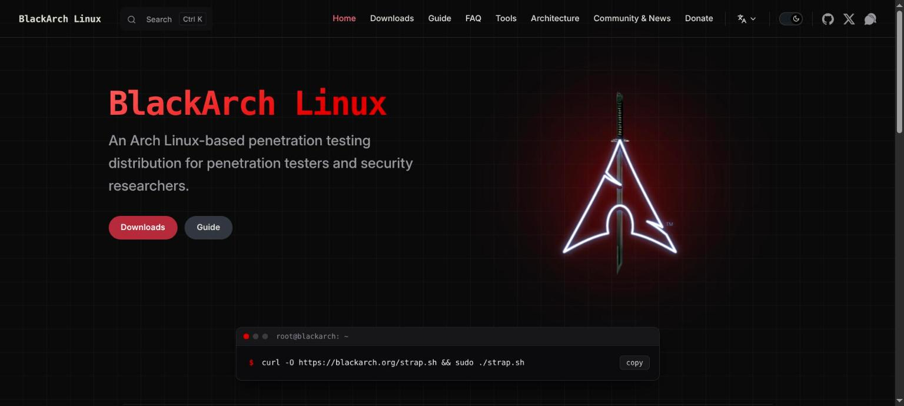
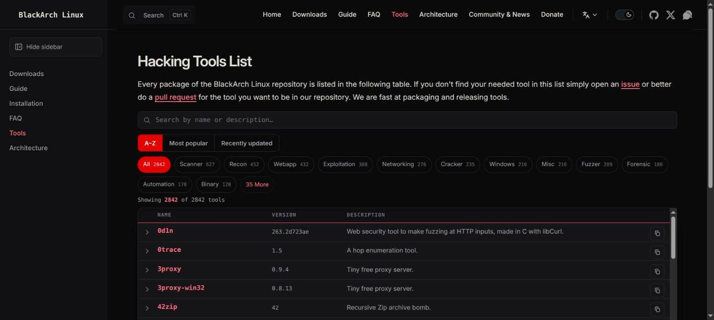
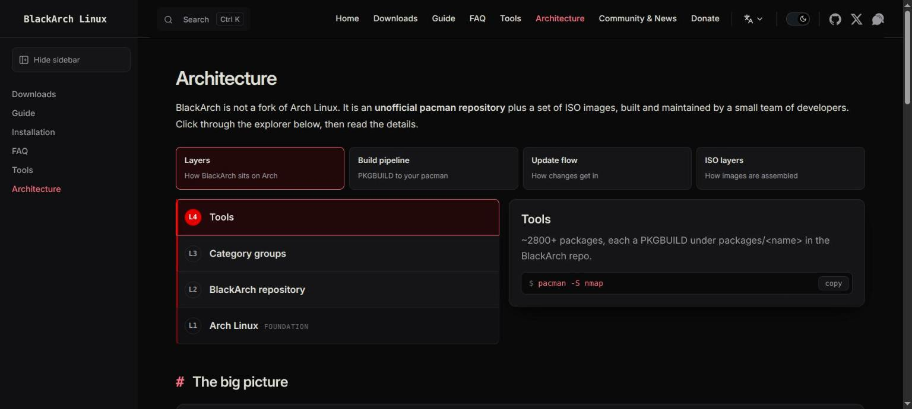
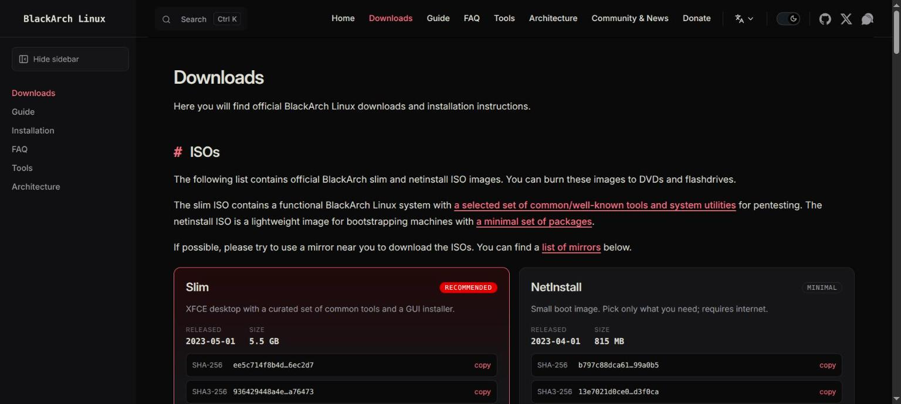

# BlackArch Linux website

A redesign of the [BlackArch Linux](https://blackarch.org) website, built with
[VitePress](https://vitepress.dev) and Vue 3. It is a static site: there is no
backend, and every page is generated at build time.

<p align="center">
  <a href="https://ru44.github.io/blackarch-website/">
    
  </a>
</p>

| Tools | Architecture | Downloads |
| :---: | :---: | :---: |
| [](https://ru44.github.io/blackarch-website/tools) | [](https://ru44.github.io/blackarch-website/architecture) | [](https://ru44.github.io/blackarch-website/downloads) |

- Live site: <https://ru44.github.io/blackarch-website/>
- Languages: English plus Arabic, Armenian, Brazilian Portuguese, Chinese, French, German, Greek,
  Indonesian, Italian, Portuguese, Romanian, Russian, Spanish and Turkish
- Report a security problem: see [SECURITY.md](SECURITY.md)
- What changed and when: see [CHANGELOG.md](CHANGELOG.md)

## Getting started

Requirements: Node.js 22 and [pnpm](https://pnpm.io) 10 (the versions CI uses).

```bash
pnpm install
pnpm dev        # dev server with hot reload
```

| Command             | What it does                                                                    |
| ------------------- | ------------------------------------------------------------------------------- |
| `pnpm dev`          | Start the dev server                                                            |
| `pnpm build`        | Production build into `src/.vitepress/dist`                                     |
| `pnpm preview`      | Serve the production build locally                                              |
| `pnpm check`        | Everything CI runs: formatting, lint and build                                  |
| `pnpm format`       | Format the code with Prettier                                                   |
| `pnpm format:check` | Check formatting without changing files (what CI should run)                    |
| `pnpm lint`         | Lint with [oxlint](https://oxc.rs/docs/guide/usage/linter.html)                 |
| `pnpm gen:locales`  | Regenerate the per-language page stubs (see [Translating](#translating))        |
| `pnpm sync:mirrors` | Refresh the mirror list from blackarch.org                                      |
| `pnpm sync:wiki`    | Refresh tool package groups from the BlackArch wiki repository                  |
| `pnpm sync:updates` | Refresh tool build dates from the BlackArch package database                    |
| `pnpm sync:stars`   | Refresh the GitHub stars used for the "Most popular" ordering                   |
| `pnpm sync:links`   | Update tool links, follow moved sites and list dead links (takes a few minutes) |

The site is deployed to GitHub Pages by `.github/workflows`: `main-ci` builds every push and pull
request, and `deploy-ci` publishes after a successful build on `main`.

## Project layout

```
src/
├── content/                 The pages, one folder per language
│   ├── en/                  English pages (served from the site root)
│   ├── <code>/              Other languages (it/, ar/, ...), see "Translating"
│   └── public/              Static files: logo layers, team avatars, install screenshots
├── components/              Vue components used by the pages
├── composables/             Shared Vue logic (useClipboard)
├── data/                    Site data as JSON (see "Keeping data up to date")
├── i18n/                    Translation helper, language metadata and UI strings
│   ├── index.js             useT(): looks up UI strings for the current language
│   ├── meta.json            Language names, navigation labels and search strings
│   └── locales/<code>.js    UI strings per language
└── .vitepress/
    ├── config.mjs           Site, navigation, languages and search configuration
    └── theme/               Theme entry, sidebar toggle and styles
        └── styles/          tokens.css, base.css, layout.css, rtl.css
scripts/                     Maintenance scripts (see below)
```

## Conventions

- **Colours and sizes** come from the CSS variables in `theme/styles/tokens.css`. Do not hard-code
  colours in components.
- **Component styles** are scoped and use CSS _logical_ properties (`margin-inline-start`,
  `inset-inline-end`, ...) so that right-to-left languages work without overrides.
- **User-visible text** in components goes through `useT(namespace, englishDefaults)` so it can be
  translated. English lives in the component; other languages override it in
  `src/i18n/locales/<code>.js`. Missing keys fall back to English.
- **Copy buttons** use the `useClipboard` composable.
- **Static data** (ISO list, mirrors, team, screenshots) lives in `src/data`, not in components.
- Commit messages follow [Conventional Commits](https://www.conventionalcommits.org)
  (`feat:`, `fix:`, `chore:`, ...).

## Git hooks and CI

`pnpm install` sets up [husky](https://typicode.github.io/husky/) hooks:

- **pre-commit** formats and lints the staged files (lint-staged, Prettier, oxlint).
- **commit-msg** checks the message with [commitlint](https://commitlint.js.org).

CI (`main-ci`) runs on every push and pull request: formatting check, lint, a check that the
generated language pages are up to date, and the production build. Pull requests also have their
commit messages linted. Run `pnpm check` to do the same locally.

## Translating

Every language has its own folder, for example `src/content/it/`. Pages that are not translated yet are
small stubs that show the English page under a "not translated yet" banner.

**Translate a page.** Edit `src/content/<code>/<page>.md`, replace the `<!--@include: ../en/<page>.md-->` line
with the translated text, and add `translated: true` to its frontmatter. Keep components, code
blocks, URLs and image paths as they are. Pages marked `translated: true` are never overwritten
by the generator. `src/content/it/` is a complete example.

**Translate the interface.** Copy `src/i18n/locales/en`-style keys from an existing file such as
`src/i18n/locales/it.js` and translate the values.

**Add a language.**

1. Add an entry to `src/i18n/meta.json` (copy an existing one). Set `"dir": "rtl"` for
   right-to-left languages.
2. Create `src/i18n/locales/<code>.js` and import it in `src/i18n/index.js`.
3. Run `pnpm gen:locales` to create the page stubs, then `pnpm build` to check.

## Keeping data up to date

| Data                | File                                                         | How to update                                                                                                                                                                                                                                        |
| ------------------- | ------------------------------------------------------------ | ---------------------------------------------------------------------------------------------------------------------------------------------------------------------------------------------------------------------------------------------------- |
| Mirrors             | `src/data/mirrors.json`                                      | `pnpm sync:mirrors` (copies the official list on blackarch.org)                                                                                                                                                                                      |
| Tool package groups | `src/data/tool-groups.json`, `tool-docs.json`                | `pnpm sync:wiki` (reads [anunna/blackarch-wiki](https://github.com/anunna/blackarch-wiki))                                                                                                                                                           |
| ISO images          | `src/data/images.json`                                       | Edit by hand when a new image is released: release date, size, file name and checksums. Take SHA1 from <https://blackarch.org/downloads.html>, check the downloaded file against it, then compute the others (`sha256sum`, `openssl dgst -sha3-256`) |
| `strap.sh` checksum | `src/content/en/downloads.md`, `src/content/it/downloads.md` | Update the `sha256sum -c` line. Check the script against the SHA1 on the official downloads page first, then run `sha256sum strap.sh`                                                                                                                |
| Tool update dates   | `src/data/tool-updates.json`                                 | `pnpm sync:updates` (build dates from the official package database)                                                                                                                                                                                 |
| Tool popularity     | `src/data/tool-stars.json`                                   | `pnpm sync:stars` (GitHub stars; needs `GITHUB_TOKEN` or the `gh` CLI)                                                                                                                                                                               |
| Tool links          | `src/data/tools/*.json`, `tool-dead-links.json`              | `pnpm sync:links` (current URLs from the package database, Google Code archive and redirects; dead links are tagged on the Tools page)                                                                                                               |
| Tool list           | `src/data/tools/*.json`                                      | One file per category. `scripts/convert_files_to_json.sh` converts the pipe-separated package lists (`name\|version\|description\|url`)                                                                                                              |
| Team                | `src/data/developers.json`                                   | Add `github` and `avatar` (a file in `src/content/public/team/`) when known                                                                                                                                                                          |
| Supporters          | `src/data/donors.json`                                       | Add new donations at the top                                                                                                                                                                                                                         |
| Screenshots         | `src/data/screenshots.json`                                  | Files are loaded from blackarch.org/images/screenshots                                                                                                                                                                                               |

After changing data, run `pnpm build` and check the affected page.

## Contributing

Fixes and translations are welcome. Open an issue first for larger changes. Every page has an
"Edit this page on GitHub" link.

1. Fork the repository and create a branch.
2. Make your change, then run `pnpm check`.
3. Open a pull request and describe what changed and why.

BlackArch Linux itself, its packages and its tools are maintained in the
[BlackArch organization](https://github.com/BlackArch). Problems with the distribution belong there,
not here.
